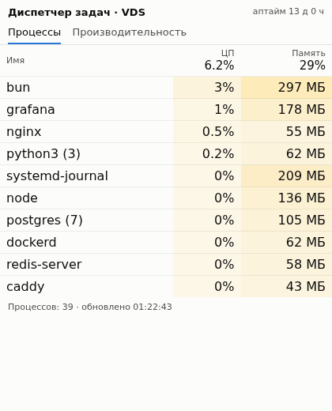
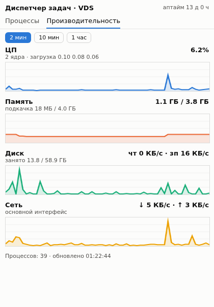

<div align="center">

# 📊 tg-taskmgr

**A live server task manager that runs *inside* a Telegram chat.**

Processes, CPU, memory, disk and network of your Linux box, with an hour of history,<br>
rendered as a native Telegram HTML widget. Nothing to install on the phone, no web server, no open ports.

[](LICENSE)


&nbsp;&nbsp;

</div>

---

## ✨ Features

- **Processes tab.** Top 10 processes grouped by name, CPU % and RAM, with heat-map cells like the Windows Task Manager.
- **Performance tab.** CPU, memory, disk I/O and network graphs over **2 min / 10 min / 1 hour**. Hover or drag across a graph to read any past point.
- **Always recording.** The sampler keeps the last hour in memory, so history is there the moment you open the widget.
- **Adapts to Telegram.** Picks up the chat theme (light or dark), with colors tuned for both.
- **Polite to limits.** Polls every 5 s, backs off up to 30 s on `rate_limited`, stops when the chat is hidden, and pauses after 10 minutes until you tap *Continue*.
- **Tiny and dependency-free.** Python stdlib reads `/proc`, one Bun script answers queries, and the widget is plain HTML/JS at ~3 KB compressed (the limit is 4 KB).

## 🧩 How it works

```
 ┌──────────────┐  every 2 s  ┌─────────────────────────┐
 │  sampler.py  │ ──────────▶ │ /run/taskmgr/state.json │
 │ (reads /proc)│             │ snapshot + 1 h history  │
 └──────────────┘             └────────────┬────────────┘
                                           │ read per query
 ┌──────────────┐ widget_query ┌───────────┴──┐
 │ widget.html  │ ───────────▶ │  handler.ts  │  ≤ 1024 chars
 │ (in Telegram)│ ◀─────────── │  (via bot)   │  answer
 └──────────────┘ answerWidget └──────────────┘
                     Query
```

Telegram widget answers are capped at **1024 characters**, so history is packed as base64url
strings: one character per point, 64 levels per series, about 120 points per graph. The process list
is trimmed until the answer fits.

## 🚀 Quick start

> Requires a Linux server with Python 3.9+, [Bun](https://bun.sh), and a bot token from [@BotFather](https://t.me/BotFather).

```bash
# 1. Get the code
sudo git clone https://github.com/romankaveev/tg-taskmgr /opt/tg-taskmgr

# 2. Start the sampler (writes /run/taskmgr/state.json every 2 s)
sudo cp /opt/tg-taskmgr/taskmgr-sampler.service /etc/systemd/system/
sudo systemctl enable --now taskmgr-sampler

# 3. Run the example bot (only ADMIN_ID can open the widget)
cd /opt/tg-taskmgr
BOT_TOKEN=123:abc ADMIN_ID=123456789 bun run bot.ts
```

Send `/taskmgr` to your bot. That's it.

## 🔌 Using it in your own bot

Already have a bot? You don't need `bot.ts`. Wire in two calls:

```ts
// send the widget
await api('sendWidget', { chat_id, html: widgetHtml, allow_queries: true })

// on update.widget_query: run handler.ts and reply
// stdin  → {"data": "a2" | "a10" | "a60"}       (range in minutes)
// stdout → {"answer": "<json string ≤ 1024 chars>"}
await api('answerWidgetQuery', { widget_query_id: q.id, data: answer })
```

> [!WARNING]
> The widget exposes process names and load of your server. **Check `widget_query.from.id`**
> before answering. `bot.ts` only answers `ADMIN_ID`.

## 📁 Files

| File | What it does |
|---|---|
| [`sampler.py`](sampler.py) | Samples `/proc` every 2 s, keeps 1 h of history, writes the state file atomically |
| [`handler.ts`](handler.ts) | Turns the state file into a ≤ 1024-char answer for the requested range |
| [`widget.html`](widget.html) | The UI that Telegram renders: tabs, table, canvas graphs, polling with backoff |
| [`bot.ts`](bot.ts) | Minimal reference bot: `/taskmgr` command and admin-only query handling |
| [`taskmgr-sampler.service`](taskmgr-sampler.service) | systemd unit (`DynamicUser`, 64 MB memory cap, auto-restart) |

## ⚙️ Tweaking

| What | Where |
|---|---|
| Sample interval | `STEP` in `sampler.py` |
| History ranges and points | `RANGES` in `sampler.py` and `PT` in `widget.html` |
| Poll interval and auto-pause | `dl=5e3` and `6e5` in `widget.html` |
| Number of processes | `[:10]` in `sampler.py` |
| Labels | Strings in `widget.html` (UI is in Russian; translate freely, then check the 4 KB limit) |

## ❓ FAQ

<details>
<summary><b>Why not a Web App / Grafana / Netdata?</b></summary>

Those need a public HTTPS endpoint or a separate app. Here the bot's own long polling is the
transport: no ports, no TLS certs, no dashboard to secure.
</details>

<details>
<summary><b>How much does the sampler cost?</b></summary>

One pass over `/proc` every 2 s. On a 2-vCPU VPS that's well under 1% CPU and ~15 MB RSS,
with a 64 MB cap in the unit.
</details>

<details>
<summary><b>Docker / containers?</b></summary>

The sampler sees whatever `/proc` it's given. Run it on the host to see everything.
</details>

## 📄 License

[MIT](LICENSE) © 2026 Roman Kaveev
